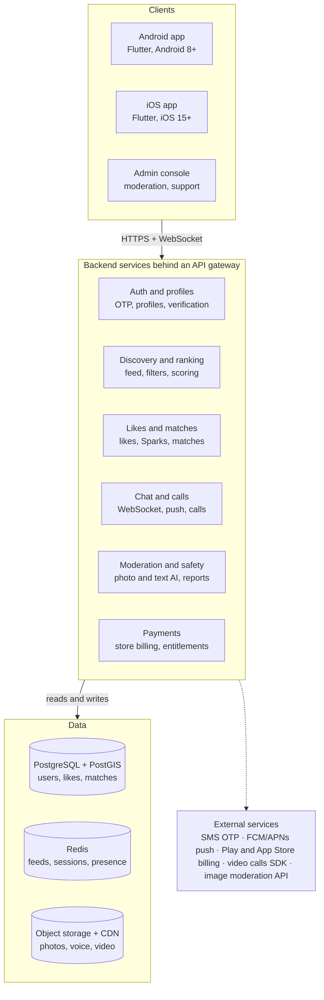

# PRD: Hinge-Style Dating App

Oct 21, 2026 · Status: Draft v0.1

## 1. Overview

**Working name:** Kindred (placeholder). A relationship-first dating app for Android and iOS where people match by reacting to specific parts of a profile, not by swiping on photos.

**Problem.** Swipe apps reward volume over intent. Users report fatigue, low-effort openers, ghosting and matches that never turn into dates. Profiles built only on photos give little to start a conversation with.

**Vision.** Help people go on good first dates and leave the app because they found someone. Success is measured in dates and relationships, not time spent in the app.

**How it works, in one line:** rich profiles (photos + written, voice and video prompts) → users like or comment on one specific item → the other person sees who liked what and decides → matched pairs chat with nudges toward meeting → post-date feedback trains the recommendations.

**Positioning.**

| App | Core mechanic | Our difference |
| --- | --- | --- |
| Hinge | Prompts, likes on specific content, daily curated picks | Same intent-led model, plus stronger verification, regional language support and a lower price point for India first |
| Tinder | Fast photo swiping | Slower, quality-led; every like carries context |
| Bumble | Women message first | Either side can open, but every like starts with a reason |
| Aisle / regional apps | Intent-led, India-focused | Modern prompt-led UX and voice/video prompts as default |

## 2. Goals, non-goals and success metrics

The north star is **weekly conversations that reach a date-intent moment** (phone number shared, date proposed, or "We met" confirmed).

**Goals (first 12 months)**

1. Launch MVP on Android and iOS in one launch city, then expand city by city.
2. Reach a healthy two-sided market: a gender ratio no worse than 65:35 among active users in each launch city.
3. Prove that likes with context produce more conversations per match than a swipe baseline.
4. Reach paying conversion that covers marketing spend in the launch city.
5. Keep the app safe: fast report handling and verified profiles as the norm.

**Non-goals for v1**

- Friend-finding, networking or group modes.
- Live streaming, public feeds or social posting.
- Web app (mobile only).
- Events or in-person meetup hosting.

**Metrics**

| Metric | Definition | Target (hypothesis) |
| --- | --- | --- |
| Profile completion | Signups who finish 6 photos + 3 prompts | 70% |
| Verification rate | Active users with selfie verification | 60% |
| Like-to-match | Likes sent that become matches | 8–12% |
| Match-to-conversation | Matches with at least 2 messages each way | 50% |
| Date-intent rate | Conversations reaching a date-intent moment | 15% |
| D30 retention | Signups still active on day 30 | 25% |
| Free-to-paid | Monthly actives on a paid plan | 5–8% |
| Report resolution | Median time to action a safety report | Under 24 hours |

Targets are starting hypotheses to be reset after the first 8 weeks of live data.

## 3. Target users and journeys

Primary users are single urban adults aged 22–35 who want a serious relationship and are tired of swipe apps. Launch market is India (metro and tier-2 cities), with the product built to work globally.

**Personas**

| Persona | Who | Needs | Frustrations today |
| --- | --- | --- | --- |
| Ananya, 27 | Product designer, Bengaluru | Matches who read her profile; feeling safe | Low-effort "hi" messages, fake profiles, harassment |
| Rohit, 29 | Software engineer, Pune | Real conversations, not endless swiping | Few matches, no idea why, paywalls everywhere |
| Meera, 32 | Doctor, Indore | Serious intent, privacy from colleagues and family | Being seen by people she knows; casual-only users |
| Sam, 25 | Student moving to work, Delhi | A low-pressure way to meet new people in a new city | Apps that feel like a game; cost |

**Key journeys**

1. **First session:** install → phone OTP → basics (name, age, gender, who to see, location) → 6 photos → 3 prompts → selfie verification → first curated feed.
2. **Sending interest:** browse a profile → like a photo or prompt → optionally add a comment → like goes to that person's Likes You list.
3. **Receiving interest:** open Likes You → see what was liked and the comment → match or remove.
4. **Conversation to date:** chat → voice note or video call → nudge to plan a date → share date details with a trusted contact.
5. **After the date:** "We met" prompt a few days later → private feedback → better recommendations; option to pause or delete the account if the user found someone.

## 4. Feature requirements

Priority: **P0** = MVP launch blocker, **P1** = within 3 months of launch, **P2** = later.

### 4.1 Onboarding and account

| ID | Requirement | Priority |
| --- | --- | --- |
| ON-1 | Sign up with phone number + OTP; optional Google / Apple sign-in | P0 |
| ON-2 | Age gate: users must be 18+; date of birth required and locked after setup | P0 |
| ON-3 | Collect name, gender (inclusive options), who they want to see, location, height, intent (long-term, long-term open to short, figuring it out) | P0 |
| ON-4 | Require 6 photos and 3 prompts before the profile goes live | P0 |
| ON-5 | Selfie video verification with a blue-tick badge | P0 |
| ON-6 | Pause account (hidden from discovery, chats kept) and full account deletion | P0 |
| ON-7 | Language choice: English + Hindi at launch | P1 |

### 4.2 Profile

| ID | Requirement | Priority |
| --- | --- | --- |
| PR-1 | 6 photo/video slots, reorderable, with optional captions | P0 |
| PR-2 | Prompt library of 80+ written prompts; user picks 3 | P0 |
| PR-3 | Voice prompt (up to 30 seconds) and video prompt (up to 30 seconds) | P1 |
| PR-4 | Vitals: work, education, hometown, religion, languages, drinking, smoking, family plans; each with a show/hide toggle | P0 |
| PR-5 | Prompt polls ("Two truths and a lie" style) that others answer as their like | P2 |
| PR-6 | Profile preview: see your profile as others see it | P0 |

### 4.3 Discovery and likes

| ID | Requirement | Priority |
| --- | --- | --- |
| DI-1 | Vertical scrolling profile card, one person at a time; no swipe gestures | P0 |
| DI-2 | Like a specific photo or prompt; optional comment up to 150 characters | P0 |
| DI-3 | Skip (X) a profile; skipped profiles can return later | P0 |
| DI-4 | Daily like limit for free users (proposed 8 per day) | P0 |
| DI-5 | Standouts: a daily set of high-compatibility profiles, liked with a premium "Spark" (our roses equivalent) | P1 |
| DI-6 | Most Compatible: one recommended profile per day | P1 |
| DI-7 | Undo last skip (paid) | P1 |

### 4.4 Likes You and matching

| ID | Requirement | Priority |
| --- | --- | --- |
| LM-1 | Likes You list shows each liker with the item they liked and their comment | P0 |
| LM-2 | Free users see likes one at a time in order; paid users see all and can sort | P0 |
| LM-3 | Match happens when the receiver likes back; the original comment opens the chat | P0 |
| LM-4 | Sparks and likes with comments are shown first | P1 |

### 4.5 Chat and calls

| ID | Requirement | Priority |
| --- | --- | --- |
| CH-1 | Real-time text chat with read receipts (can be turned off), typing indicator, GIFs | P0 |
| CH-2 | Voice notes up to 60 seconds | P0 |
| CH-3 | In-app voice and video calls without sharing phone numbers | P1 |
| CH-4 | "Your turn" reminder when a reply has waited 24 hours | P1 |
| CH-5 | Unmatch removes the chat for both people; reporting stays available | P0 |
| CH-6 | Harmful-message detection that asks the sender "Are you sure?" before sending | P1 |

### 4.6 After the date

| ID | Requirement | Priority |
| --- | --- | --- |
| AD-1 | "We met" prompt after a chat shows date intent; private yes/no + would you see them again | P1 |
| AD-2 | Date-safety check-in: share date time and place with a trusted contact | P1 |

### 4.7 Preferences and settings

| ID | Requirement | Priority |
| --- | --- | --- |
| PF-1 | Basic filters: age, distance, gender | P0 |
| PF-2 | Advanced filters (paid): height, religion, intent, drinking, smoking, family plans, education; each can be marked a dealbreaker | P1 |
| PF-3 | Incognito mode (paid): only people you have liked can see you | P1 |
| PF-4 | Hide from contacts: upload contacts so they are never shown to you or you to them | P1 |
| PF-5 | Push notification controls per type | P0 |

## 5. Trust, safety and compliance

Safety is a launch feature, not a later add-on: no profile goes live without photo moderation, and every chat has one-tap report and block.

**Verification and moderation**

- Selfie video verification matched against profile photos; optional government ID verification later (P2), handled by a third-party provider so we never store ID images.
- Automated photo screening for nudity, minors, weapons, celebrity and stolen images, with human review for flagged items.
- Text screening on prompts and messages for abuse, scams, phone-number and payment solicitation.
- Spam and fake-account signals: device fingerprint, signup velocity, like velocity, copy-paste messages.
- Report flow with reasons; reported users are hidden from the reporter at once; high-severity reports (threats, minors, sexual violence) go to a priority queue.
- Bans apply to device and phone number, not just the account.

**Privacy**

- Show distance rounded (for example "5 km away"), never exact location.
- Phone numbers and emails are never shown to other users.
- Screenshot blocking in chat on Android; screenshot notice on iOS (P2).
- Data export and deletion on request; deleted data purged within 30 days except where law requires retention.

**Compliance (to confirm with a lawyer)**

- India: Digital Personal Data Protection Act 2023 and its rules (consent, purpose limitation, grievance officer, breach reporting) and IT Rules 2021 intermediary duties (grievance officer, takedown timelines).
- EU/UK users if expanding: GDPR and UK GDPR; sensitive data such as religion and sexual orientation needs explicit consent.
- App Store and Google Play rules for dating apps: user-generated content moderation, report and block tools, 18+ age rating, and in-app purchase rules for digital subscriptions.
- Clear Terms of Service, Privacy Policy and Community Guidelines in every supported language.

## 6. Matching and recommendations

Start with a simple, explainable ranking at launch and move to a learned model once there is enough interaction data (roughly 50,000+ likes in a city).

**Phase 1 — rules + scoring (MVP)**

1. Hard filters: mutual gender preference, age range, distance, dealbreakers, blocked/hidden contacts, already skipped recently.
2. Score each candidate on: mutual-preference fit, profile completeness, verification, recent activity, and likelihood they like back (based on their past like patterns).
3. Fairness boosts: new users get a short visibility boost; users receiving few likes are shown to people likely to engage; very popular profiles are rate-limited so attention spreads out.
4. Feed mixes about 80% best-scored and 20% exploration to keep learning.

**Phase 2 — learned model**

- Two-sided recommendation using collaborative filtering on likes and matches (the Gale–Shapley stable-matching idea Hinge cites is a useful framing for mutual fit).
- Train on signals of real success: replies, date-intent moments and "We met" outcomes, not just likes.
- Most Compatible and Standouts are generated from the top of this model.

**Guardrails**

- No ranking on attractiveness ratings from other users' photos, race or skin tone.
- Regular audits of match rates across groups to catch unfair outcomes.

## 7. Monetization

Freemium with two subscription tiers plus one-off purchases. The free tier must be good enough to get dates, or the market never reaches critical mass.

| Tier | Includes | Proposed price (India, INR) |
| --- | --- | --- |
| Free | 8 likes/day, 1 Spark/week, basic filters, chat, voice notes | ₹0 |
| Plus | Unlimited likes, see everyone who liked you, advanced filters, undo, incognito | ₹499/month · ₹1,199/3 months |
| Premium | Everything in Plus, likes from you shown first, 3 Sparks/week, read receipts on demand, priority in Standouts | ₹999/month · ₹2,399/3 months |
| Add-ons | Spark packs (3 / 12), Boost (top of local feed for 1 hour) | ₹199–₹799 |

- Prices are hypotheses; test in the launch city and use regional pricing on the stores for other markets.
- Digital subscriptions go through Google Play Billing and Apple In-App Purchase; plan for store fees (typically 15–30%).
- Revenue to watch: free-to-paid conversion, average revenue per paying user, churn by tier, refund rate.
- Safety features (verification, report, block, hide from contacts) are never paywalled.

## 8. Architecture and non-functional requirements

Build one cross-platform codebase (Flutter) for Android and iOS, a modular backend, and lean on managed services for chat infrastructure, media, push and calls so a small team can ship in months.

Both apps and the admin console call the same backend; services read and write shared data stores, and anything outside our core (SMS, push, billing, calls, image moderation) is a paid provider.

**Proposed stack**

| Layer | Choice | Alternative |
| --- | --- | --- |
| Mobile | Flutter | React Native |
| Backend | Node.js (NestJS) on containers | Go |
| Database | PostgreSQL + PostGIS for location queries | — |
| Cache and feeds | Redis | — |
| Realtime chat | Own WebSocket service | Stream or Sendbird (faster to ship) |
| Media | S3-compatible storage + CDN, server-side image resizing | — |
| Calls | Agora or Twilio SDK | — |
| Analytics and crashes | Mixpanel or Amplitude, Firebase Crashlytics | — |
| Hosting | AWS Mumbai region (ap-south-1) | GCP Mumbai |

**Non-functional requirements**

| Area | Requirement |
| --- | --- |
| Performance | Feed loads in under 1.5 s on 4G; chat messages delivered in under 500 ms (p95) |
| Availability | 99.9% monthly uptime for core APIs |
| Scale | Designed for 1M registered users; launch target 100k |
| Devices | Runs smoothly on 3 GB RAM Android phones; app download under 40 MB |
| Security | TLS everywhere, encryption at rest, OWASP MASVS checks, yearly penetration test |
| Accessibility | Screen reader labels, dynamic text size, sufficient colour contrast |
| Observability | Logs, metrics, alerts on error rate and latency; product analytics on every funnel step |

## 9. MVP scope, roadmap and launch plan

The MVP is every P0 requirement in section 4, shipped in one launch city about 6 months from kickoff with a team of roughly 2 mobile, 2 backend, 1 designer, 1 PM/founder and part-time moderation.

```mermaid
flowchart LR
    P0["0 Design<br/>Weeks 1–4<br/>User research · Brand and name · Prototype · Legal setup"]
    G1{{"Gate 1: prototype tested with 20 users"}}
    P1["1 MVP build<br/>Weeks 5–16<br/>All P0 features · Moderation tools · Verification · Store builds"]
    G2{{"Gate 2: safety tools live, store review passed"}}
    P2["2 Closed beta<br/>Weeks 17–20<br/>One city · 1,000 users · Waitlist opens · Fix top issues"]
    G3{{"Gate 3: D30 retention 20%+, reports under 24 h"}}
    P3["3 Launch<br/>Weeks 21–24<br/>Public release · Paid tiers live · Launch campaign · Ambassadors"]
    G4{{"Gate 4: paid conversion 3%+, ratio 65:35 or better"}}
    P4["4 Grow<br/>Months 7–12<br/>P1 features · Two more cities · Learned ranking · Calls, We met"]
    P0 --> G1 --> P1 --> G2 --> P2 --> G3 --> P3 --> G4 --> P4
```

Each phase starts only when the gate before it is met; the gates turn the metrics in section 2 into go/no-go checks.

**MVP includes:** phone signup, 18+ gate, profile with 6 photos and 3 written prompts, selfie verification, discovery feed, likes with comments, Likes You, matching, text chat with voice notes, basic filters, report/block, pause and delete, Plus subscription.

**MVP leaves out:** voice/video prompts, in-app calls, Standouts and Sparks, Most Compatible, We met, incognito, advanced filters, Hindi UI. All are P1.

**Launch plan**

1. **Pre-launch (weeks 12–20):** waitlist landing page, Instagram and campus ambassadors, creator partnerships; release the app only when the waitlist has a balanced pool.
2. **Beta (weeks 17–20):** invite-only, 1,000 users in one city; weekly interviews; fix the top issues.
3. **Public launch (weeks 21–24):** open signups in the city, turn on paid tiers, PR around safety and "designed for real dates".
4. **Expansion (months 7–12):** add a city only when the current one meets the gate metrics.

## 10. Risks, assumptions and open questions

| Risk | Impact | Mitigation |
| --- | --- | --- |
| Cold start: too few users in a city | Empty feeds, users leave in week one | Launch one city at a time; waitlist until a minimum pool is reached; campus and community ambassadors |
| Gender imbalance | Women flooded with likes, men get no matches | Daily like limits, women-focused safety marketing, rate-limit popular profiles |
| Fake profiles and scams | Loss of trust, bad reviews | Mandatory selfie verification, scam detection, fast bans |
| Harassment | User harm, legal exposure | Harmful-message nudges, priority queue, device bans |
| Store rejection or policy change | Launch delay, revenue hit | Follow dating-app review guidelines; moderation and reporting in place before submission |
| Too close to Hinge's design | Trade dress or IP complaints | Own visual identity, own prompt wording, own feature names (Spark, not Rose) |
| Data breach | Severe trust and legal damage | Encryption, minimal data collection, security audit before launch |

**Assumptions**

- India-first launch, English + Hindi, single launch city before expanding.
- Small founding team using a cross-platform framework.
- Users will accept a 6-photo, 3-prompt minimum in exchange for better matches.

**Open questions**

- [ ] Which launch city: a metro (Bengaluru, Pune) or a tier-2 city with less competition?
- [ ] Inclusive of all orientations from day one, or straight + LGBTQ+ phased?
- [ ] Is the free like limit 8 or 10 per day?
- [ ] Build voice/video calls in-house or use a provider (Agora, Twilio, Stream)?
- [ ] Final app name and trademark check.
